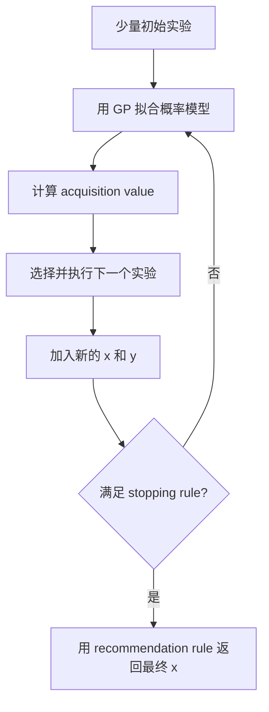

# Bayesian Optimization 基础概念：从实验到停止

这份说明用同一个直观例子解释 Phase 1 中最重要的概念。目标不是背公式，而是能清楚回答三个问题：

1. 现在已经知道什么？
2. 下一次为什么选择这个实验？
3. 什么时候有足够理由停止？

## 1. BO 到底在寻找什么？

假设我们可以控制咖啡机的水温 $x$，每次制作后得到口感评分 $y$。真实关系记为

$$
y=f(x)+\epsilon.
$$

- $x$：我们可以选择的输入，例如水温。
- $f(x)$：真实但未知的输入—结果关系。
- $y$：实际观察到的结果。
- $\epsilon$：测量噪声，例如评分人的随机变化。

BO 最终寻找的是一个好的输入

$$
x^*\in\arg\max_x f(x),
$$

不是寻找“唯一正确的一条函数”。我们只有少量实验数据，不可能确定真实曲线；我们需要的是在有限实验预算内做出好的输入决策。

当一次实验很便宜时，可以网格搜索或随机搜索。BO 的优势出现在每次实验都昂贵的情况，例如真实材料实验、长时间模拟、模型训练或自动化实验室运行。

## 2. 整个 BO loop



这里有五个不能混在一起的角色：

| 概念 | 它回答的问题 | 咖啡例子 |
|---|---|---|
| Objective function | 真实实验会产生什么结果？ | 某个水温实际得到的口感 |
| GP surrogate | 根据已有数据，哪些曲线仍然可能？ | 对所有未测试水温的预测与不确定性 |
| Acquisition function | 下一次测试哪个输入？ | 下一杯用多少度的水 |
| Stopping rule | 是否值得继续做实验？ | 再做一杯带来的潜在价值是否足够大 |
| Recommendation rule | 停止以后最终返回哪个输入？ | 使用最好实测温度，或 posterior mean 最大的温度 |

## 3. Gaussian Process 在做什么？

Gaussian process（GP）是对未知函数的概率模型：

$$
f\sim\mathcal{GP}(m(x),k(x,x')).
$$

- $m(x)$ 是 prior mean，表示观察数据之前的基准判断。
- $k(x,x')$ 是 kernel，描述两个输入的结果应该有多相似。

看到数据 $D=\{(x_i,y_i)\}$ 后，GP 得到 posterior。对一个新输入 $x_*$，预测分布通常写成

$$
f(x_*)\mid D\sim\mathcal N(\mu_*(x_*),\sigma_*^2(x_*)).
$$

- posterior mean $\mu_*(x_*)$：当前最合理的预测。
- posterior standard deviation $\sigma_*(x_*)$：在当前模型假设下的不确定性。

最核心的更新公式是

$$
\mu_*=m_*+K_{*X}(K_{XX}+\sigma_n^2I)^{-1}(y-m_X),
$$

$$
\sigma_*^2=K_{**}-K_{*X}(K_{XX}+\sigma_n^2I)^{-1}K_{X*}.
$$

直观理解：

- $K_{*X}$ 衡量新点与已观察点的相似程度。
- 新点越接近已有数据且 kernel 认为它们高度相关，预测越受已有数据影响。
- 条件化以后，靠近已观察点的不确定性通常下降。
- 这里的 uncertainty 是“给定 kernel、hyperparameters 和 noise model 之后”的不确定性，不是绝对真理。

## 4. Kernel 与 hyperparameters

以 RBF kernel 为例：

$$
k(x,x')=\sigma_f^2\exp\left(-\frac{(x-x')^2}{2\ell^2}\right).
$$

### Length scale $\ell$

$\ell$ 控制函数在多大距离内仍被认为相似。

- 小 $\ell$：相关性下降很快，模型允许快速起伏；未测区域的不确定性恢复得快。
- 大 $\ell$：远一些的点仍被视为相似，模型更平滑；稀疏数据下可能过度自信并错过窄峰。

例如两个温度相差 5°C：如果 $\ell=2$，模型认为差异可能很大；如果 $\ell=30$，模型认为两者几乎相同。

### Output scale $\sigma_f^2$

它控制 latent function 可以变化多大。较大的 output scale 允许曲线有更大的上下波动，也通常扩大远离数据处的 prior uncertainty。

### Noise variance $\sigma_n^2$

它控制观察值相对真实函数的随机波动。

- 设得太小：模型可能把噪声当成真实细节，出现过拟合和过度自信。
- 设得太大：模型可能忽略真实结构，posterior 过于平坦。

### Mean constant

在远离数据的位置，posterior 会逐渐回到 prior mean。数据很少时，mean 的设置会影响 acquisition 对未探索区域的态度。

### ARD length scales

多维输入中可以给每个维度一个 length scale：

$$
k(x,x')=\sigma_f^2\exp\left(-\frac12\sum_j\frac{(x_j-x'_j)^2}{\ell_j^2}\right).
$$

小 $\ell_j$ 表示第 $j$ 个维度上函数变化较快。使用 ARD 前必须对输入进行一致的归一化，否则 length scale 大小可能只是单位不同造成的。

## 5. Hyperparameters 怎么 fit？

常见做法是最大化 log marginal likelihood：

$$
\log p(y\mid X,\theta)
=-\frac12(y-m)^TK_\theta^{-1}(y-m)
-\frac12\log|K_\theta|
-\frac n2\log(2\pi).
$$

其中 $\theta$ 包含 length scale、output scale、noise 等参数。

- 第一项奖励能够解释数据的模型。
- 第二项惩罚不必要的复杂度和体积。
- 第三项是正态分布归一化常数。

“fit GP”是在调整这些 hyperparameters，使观察到的数据在模型下更合理。它不是在直接寻找最优 $x$。数据很少时，似然可能有多个局部最优，因此需要合理 prior、参数约束和多次 restart。

## 6. Exploration 和 exploitation

- Exploitation：去 posterior mean 较高的地方，利用当前最好的判断。
- Exploration：去 uncertainty 较高的地方，避免错过未知区域。

Acquisition function 把这两种价值合成一个便宜的分数。它不等于 objective value，也不需要真的执行实验就能计算。

### UCB

$$
a_{UCB}(x)=\mu(x)+\sqrt{\beta}\,\sigma(x).
$$

$\beta$ 大时更重视探索；小的时候更重视当前均值。

假设：

- A：$\mu=0.90,\sigma=0.05$
- B：$\mu=0.70,\sigma=0.30$

当 $\sqrt\beta=1$ 时，A 的分数是 0.95，B 是 1.00，所以选择 B。B 的预测值较低，但不确定性带来了潜在价值。

### Expected Improvement

对最大化问题，improvement 是

$$
I(x)=\max(f(x)-f_{best},0).
$$

EI 是它的 posterior expectation：

$$
EI(x)=(\mu-f_{best})\Phi(z)+\sigma\phi(z),
\qquad z=\frac{\mu-f_{best}}{\sigma}.
$$

第一项代表预测提升，第二项代表 uncertainty 的价值。代码使用 LogEI，是为了避免非常小的 EI 在计算机中下溢成零；LogEI 不改变理想条件下的最大点。

### PI、Thompson Sampling 和 MES

- PI：最大化超过 incumbent 的概率，但可能偏爱“很可能只提高一点点”的位置。
- Thompson Sampling：从 joint posterior 抽一条可能函数，再寻找这条函数的最大点。
- MES：寻找最能减少“未知最大值”不确定性的实验，而不是只看立即提升。

这些 acquisition 可以使用同一个 GP，但会选择不同的下一个 $x$。

## 7. Stopping rule 与 recommendation rule

停止和返回结果是两个问题。

### Recommendation

无噪声 Phase 1 例子采用 best observed point：

$$
\hat x_t\in\arg\max_{i\le t}y_i.
$$

也可以返回 posterior mean 最大的点，但必须在比较算法之前固定规则。

### Simple regret

$$
r_t=f^*-f(\hat x_t).
$$

- $f^*$ 是允许域内的真实最优值。
- $\hat x_t$ 是停止时返回的输入。
- $r_t$ 越小，最终决策越接近最优。

“可接受”需要明确 tolerance：

$$
r_t\le\epsilon.
$$

### 为什么连续几次没有提升不能证明应该停止？

当前最优值不变可能只是 acquisition 正在探索。Phase 1 的固定种子运行中，前三次 BO 迭代都没有提高 incumbent，但第四次和第六次找到了更好的值。因此 stagnation 只是 heuristic，不是质量证明。

### 概率型停止规则

一种目标形式是

$$
P(r_t\le\epsilon\mid D_t)\ge1-\delta.
$$

它表示：在拟合后的 posterior 下，最终 recommendation 至少有 $1-\delta$ 的概率位于最优值的 $\epsilon$ 范围内。

必须注意：这个概率依赖 GP 模型、hyperparameters、候选域近似和 Monte Carlo 精度。模型错了时，posterior 也可能非常自信地错。

## 8. BoTorch 中每一步分别做什么？

```python
model = SingleTaskGP(train_x, train_y)
fit_gpytorch_mll(mll)            # fit GP hyperparameters
acq = LogExpectedImprovement(...)# build a cheap decision score
x_next, _ = optimize_acqf(acq)   # optimize acquisition, not objective
y_next = objective(x_next)       # exactly one new expensive evaluation
```

需要区分三种优化：

1. 最大化 marginal likelihood：fit GP hyperparameters。
2. 最大化 acquisition：选择下一次实验位置。
3. 最大化未知 objective：整个 BO 的最终目标，但无法直接完成，只能通过有限实验逐步接近。

## 9. 这个项目真正要研究什么？

项目不是证明 BO 能在一个简单例子上找到峰值。真正的问题是：

> 在不同 landscape、acquisition strategy 和模型条件下，哪种 stopping rule 能减少实验次数，同时仍以足够高的可靠性返回 acceptable solution？

所以后续评估不能只看平均停止时间，还必须看：

- 停止时 simple regret；
- false stop rate；
- 达到可接受解的概率；
- 节省了多少 evaluation；
- 在 hidden peak、短 length scale、噪声和模型 misspecification 下是否失败；
- stopping 计算本身的 Monte Carlo error 和 runtime。

## 10. Phase 1 最重要的五句话

1. BO 寻找好的输入 $x$，GP 只是帮助搜索的概率地图。
2. Posterior mean 是预测，posterior uncertainty 是在模型假设下的不确定性。
3. Acquisition 选择下一次实验；stopping 判断是否继续；recommendation 决定最终返回什么。
4. Hyperparameters 会改变相似性、平滑度、uncertainty 和最终采样决策，因此必须记录并诊断。
5. 一个停止规则只有在节省 evaluations 的同时保持低 regret 和低 false-stop rate，才真正有价值。

