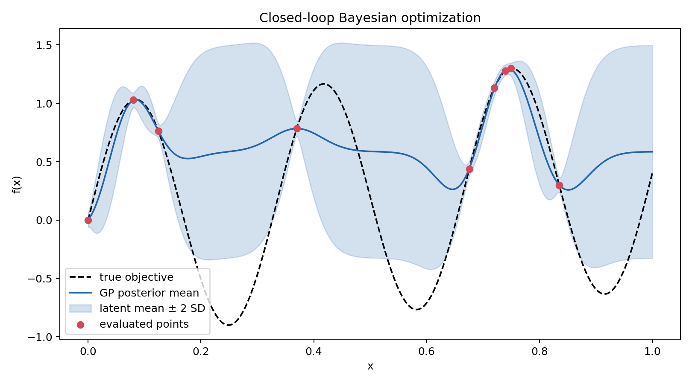
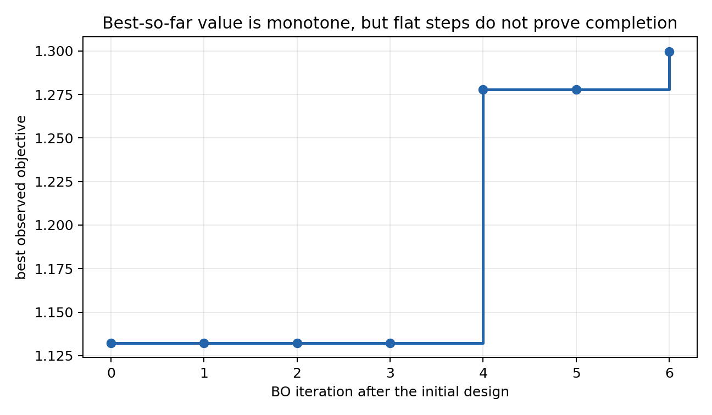
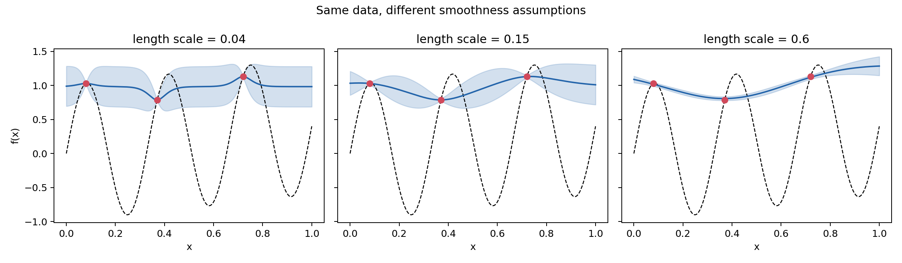

# Phase 1 Completion Report

Phase 1 establishes the shared language, minimum mathematical foundation, and
one reproducible Bayesian-optimization (BO) loop needed for the stopping-rule
study. It is a learning and validation milestone, not evidence that any
stopping rule is already reliable.

## Completion matrix

| Workplan item | Evidence | Status |
|---|---|---|
| Task 1.1: ten-paper annotated reading list | [`reading_list.md`](reading_list.md) | Complete |
| Task 1.2: introductory guide | [`bo_primer.md`](bo_primer.md) | Complete |
| Supporting concept map and worked calculation | [`bo_concept_map.md`](bo_concept_map.md), [`bo_gp_stopping_rules_study_guide.md`](bo_gp_stopping_rules_study_guide.md) | Complete |
| Chinese fundamentals guide | [`bo_basics_cn.md`](bo_basics_cn.md) | Complete |
| Task 1.3: visual BoTorch example | [`01_bo_intro.ipynb`](../examples/01_bo_intro.ipynb) | Complete and executed |
| Script version and saved artifacts | [`bo_intro.py`](../examples/bo_intro.py), [`results/phase1`](../results/phase1) | Complete |
| Hyperparameter misspecification example | [`02_lengthscale_sensitivity.py`](../examples/02_lengthscale_sensitivity.py) | Complete |
| Automated checks | [`test_bo_intro.py`](../tests/test_bo_intro.py) | 6 tests passing |
| Presentation and speaking guide | [`presentations`](../presentations) | Complete |

## Reproducible toy experiment

The example maximizes

$$
f(x)=\sin(6\pi x)+0.4x,\qquad x\in[0,1]
$$

with three initial observations followed by six sequential LogEI decisions.
The optimizer therefore receives exactly nine objective evaluations. A dense
grid is used only after the run for visualization and retrospective scoring.

### Fixed-seed result

| Quantity | Value |
|---|---:|
| Random seed | 17 |
| Initial observations | 3 |
| BO iterations | 6 |
| Total objective evaluations | 9 |
| Returned best observed input | 0.7494546 |
| Returned objective value | 1.2997290 |
| Dense-grid reference input | 0.7511500 |
| Dense-grid reference value | 1.3002251 |
| Retrospective simple regret | 0.0004961 |

The exact trace is stored in
[`bo_intro_trace.csv`](../results/phase1/bo_intro_trace.csv), and the machine-
readable summary is in
[`bo_intro_summary.json`](../results/phase1/bo_intro_summary.json).





The flat best-so-far value during the first three BO iterations is important:
stagnation did not imply that the search was finished. The fourth and sixth
iterations subsequently improved the incumbent.

## Hyperparameter sensitivity result

The second example holds the observations fixed and changes only the Matérn
kernel length scale. It shows that posterior shape and uncertainty are not
facts supplied directly by the data; they are conditional on modeling choices.



- A very short length scale allows rapid changes and weak correlation between
  nearby inputs.
- A moderate length scale shares information locally without forcing the
  function to be globally smooth.
- A very long length scale can oversmooth the oscillations and create
  misleading confidence between sparse observations.

This is directly relevant to stopping: a misspecified GP can become confident
before the optimizer has found the best region.

## What the implementation proves—and does not prove

The Phase 1 run demonstrates that:

1. the GP is fitted only to requested observations;
2. LogEI is optimized as a cheap decision function;
3. each loop iteration makes exactly one new objective call;
4. the best observed recommendation is tracked separately from the next-point
   decision;
5. the implementation is deterministic under the fixed seed in the tested
   environment; and
6. saved outputs can be regenerated from source.

It does **not** prove that:

- LogEI is best for the later benchmark;
- the GP credible interval has real-world frequentist coverage;
- a small acquisition value certifies small regret;
- the dense visualization grid is available to a real optimizer; or
- the example's success transfers to hidden peaks, anisotropy, noise, or model
  misspecification.

## Verified environment

The completed run used:

- Python 3.12.14
- PyTorch 2.14.1
- BoTorch 0.18.1
- GPyTorch 1.15.2

The version ranges needed for a clean environment are listed in
[`requirements-phase1.txt`](../requirements-phase1.txt). The exact observed
versions are also written to the JSON result.

## Verification commands

```bash
python -m venv .venv
source .venv/bin/activate
pip install -r requirements-phase1.txt
python examples/bo_intro.py
python examples/02_lengthscale_sensitivity.py
pytest -q
```

Expected test result: `6 passed`.

## Questions carried into Phase 2

1. Which kernel and priors should be fixed before comparing stopping rules?
2. How should output scaling be defined so that an epsilon such as `0.02` has
   comparable meaning across functions?
3. Should the noiseless pilot use a learned noise floor or a fixed numerical
   noise value?
4. How will posterior calibration be measured before interpreting probability-
   based stopping rules?
5. Which failures should count as optimizer failures, model-fitting failures,
   and stopping-rule failures?
6. How many random-field realizations are needed after the first fixed-field
   pilot?

These questions are recorded rather than hidden because Phase 1 is complete
only when its assumptions and unresolved choices are visible.

